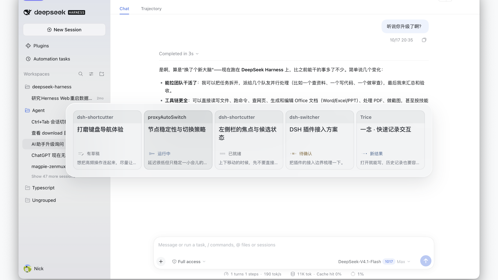

# DSH Switcher

DeepSeek Harness 的 Ctrl + Tab 最近会话切换器。独立于 `dshMagicShortcuts`，可以同时使用。

## 使用

- `Ctrl + Tab` 切回上一个会话。按住 Ctrl，140ms 后显示横向浮层，继续点 Tab 循环选择。
- `Ctrl + Shift + Tab` 反向选择，松开 Ctrl 提交。
- `Esc` 取消；`Enter` 或点击卡片也可确认。失焦、窗口隐藏、输入法组合时取消。
- 当前会话和四个最近会话跨工作区展示，打开期间顺序固定。初次使用按最近活动补齐，过滤归档、已删除和空白会话；未访问的子代理不进入候选。

卡片按 **项目 / 工作区 → 两行会话标题 → 状态 → 单行最后输入** 排列。项目名优先使用 DSH 工作区名称，未分组会话回退到目录名；重命名和归属变化实时更新。状态读取 DSH 的运行、待确认/待回应、未读结果及草稿事实，保留完整 11「五拍」动效。最后输入仅作辅助线索，停留可查看原文摘录；空白、加载与读取失败有各自提示。

## 构建与安装

使用 Node.js 20 或更新版本，不需要第三方构建依赖：

```sh
npm run build
npm test
npm run check
npm run pack:local
dsh plugin --profile desktop add /absolute/path/to/dsh-switcher/dist/dsh-switcher-0.1.5.tgz --offline --ignore-scripts
```

安装包只有客户端代码、空的宿主入口、插件补丁、包信息和说明。使用官方插件安装路径，不修改 DSH 应用包。针对 DSH **0.2.1-rc.2** 的公开客户端服务开发，目前本机验证平台为 macOS。

Ctrl + Tab 由主文档直接处理完整的按下/松开事件，不通过宿主原生快捷键转发。当前支持会话主界面；焦点位于独立的内嵌网页或 iframe 内部时不接管。终端入口和 Windows 尚未做原生验证。普通浏览器的 Ctrl + Tab 由浏览器占用。

卸载可在 DSH Plugins 中停用或移除 `dsh-switcher`。插件卸载时释放按键监听、会话预览引用、样式和动画。

## 已选视觉

当前采用 **01「分签」/ Dia 尺寸 / 完整 11「五拍」图标**。用户于 2026-10-19 从题签精修的 12 版中最终选择 01，正式实现独立题签和卡片细边。采用该方案的中性半透明明暗材质；此前 B「轻透」、05 亮色 / 05 raised 暗色继续归档保留。

整体 942 × 190，单项 182 × 158，题签高 33px，图标 20px。项目 12px、标题 15px，状态和最后输入 11px；长项目名及原话单行省略，标题最多两行。不足五项时容器随数量缩短，窄窗口横向滚动。选中卡片通过柔和的明度差区分：亮色为浅灰压深，暗色为轻微提亮，无缩放和额外操作提示。浮层使用网页 `backdrop-filter`，尊重减少动态效果、减少透明度及增强对比度设置。



## 开发与历史方案

2026-10-19 的 [28 案设计研究台](http://127.0.0.1:4382/demo/design-lab/?v=25&theme=dark) 支持明暗、B 基准对照、精选并排、长短文案、英文/代码、窄窗口及模拟主题色。研究代码在 `src/study/`，演示入口在 `demo/design-lab/`，不进入正式插件构建。逐案说明与验证边界见 [设计记录](design/reviews/2026-10-19-design-lab/review.html)。

研究台可读取 `demo/design-lab/private/codex-conversations.json` 中的本机真实聊天快照（5 个标题、最后一条用户输入与 `workspaceName`），有快照时默认选中“Codex 真实对话”；原示例场景继续保留。该目录及包含真实文案的截图目录已忽略，不进入 Git 或插件包。状态图标仍为演示，并非 Codex 实时状态；引用聊天仅显示名称，原话不摘要、不润色。没有本机快照时自动使用原示例。Workspace 使用 Codex 工作目录匹配到的项目名称，列在会话标题下方；“项目 / Workspace”开关（`workspace=0`）可恢复上一版单行页脚。托盘与卡片整体尺寸不变，按住 B 仍显示原始基准。

同日追加 [8 版信息层级研究](http://127.0.0.1:4382/demo/recognition/?layout=shared&theme=dark&scene=real)：根据真实文案过长、难以快速识别的反馈，让项目、状态、标题优先，最后输入成为辅助线索。01 项目索引、02 标题主导、03 状态领读、04 项目题签、05 选中再读、06 共用旁注、07 状态侧栏、08 横向清单。05 只展示选中会话的原话；06 在整条浮层下沿展示所选原话。支持 8 版对照、明暗、材质、长名称和空白压力场景，以及按住看上一版。8 版维持 942×190 外框与完整五拍图标；06 调整内部卡片高度为 124，08 为五行列表。原先 28 案及正文优先的布局均保留。本轮仍只验证浏览器原型，没有改动正式插件。

用户选中 04「项目题签」后，继续做了 [12 版题签精修](http://127.0.0.1:4382/demo/project-tabs/?layout=split&theme=dark&scene=real)，最终选择 01「分签」并接入正式插件。页面保留全部 12 版及当时的取舍、原案对照、真实聊天、明暗、材质和可读性设置。三轮研究固定引用 B 的归档样式，独立于生产实现。[历史研究 QA](design/reviews/2026-10-19-design-lab/project-tabs-qa.md) 与 [01 正式实现 QA](design-qa.md) 分别记录，真实聊天截图仅存在于本机忽略目录。

```sh
npm run dev
```

- 历史 05 设计基线：`http://127.0.0.1:4382/`
- 保留的材质对照：`http://127.0.0.1:4382/demo/materials/?material=glass&theme=dark`
- 正式界面代码的样例验证：`http://127.0.0.1:4382/demo/plugin.html`

样例页使用正式的视图和动画模块，但数据是 fixtures；它不能代替原生 DSH 验证。原生接入与验证记录见 [design/integration.md](design/integration.md)。

```text
src/plugin/          正式插件、真实数据适配、独立视图与动效
src/                 保留的设计基线源码
demo/                示例背景、fixture 与比较控件（不打包）
design/archive/      全部历史设计（不打包）
test/                MRU、状态、数据适配与生命周期测试
scripts/             独立构建、预览服务及语法/资源检查
lib/                 生成的插件文件（忽略 Git）
dist/                可安装 tgz（忽略 Git）
```

历史方案和原项目均保留。主入口不依赖同级项目或仓库外资源。MRU 仅在当前窗口 sessionStorage 保存会话 ID；提示词与草稿不持久化、不发送到外部服务。预览期间最多额外保留五个会话，关闭立即释放；不轮询所有会话历史，不调用模型。
