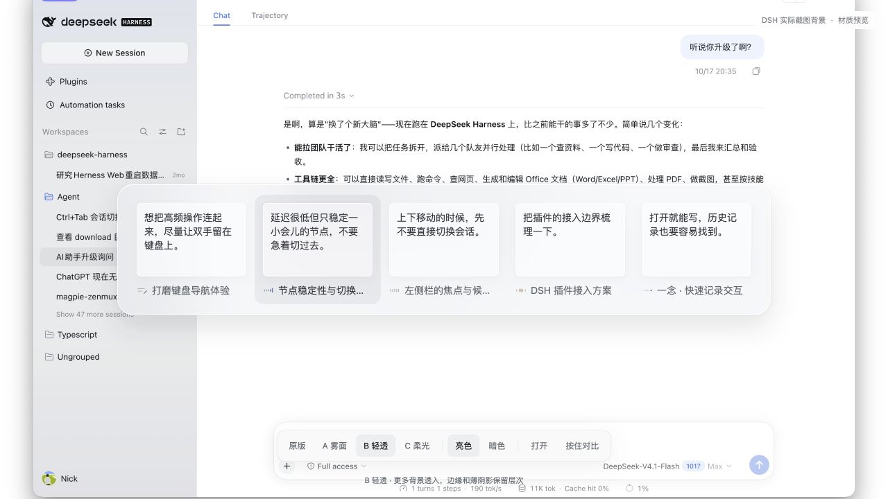

# DSH Switcher

DeepSeek Harness 的 Ctrl + Tab 最近会话切换器。独立于 `dshMagicShortcuts`，可以同时使用。

## 使用

- `Ctrl + Tab` 切回上一个会话。按住 Ctrl，140ms 后显示横向浮层，继续点 Tab 循环选择。
- `Ctrl + Shift + Tab` 反向选择，松开 Ctrl 提交。
- `Esc` 取消；`Enter` 或点击卡片也可确认。失焦、窗口隐藏、输入法组合时取消。
- 当前会话和四个最近会话跨工作区展示，打开期间顺序固定。初次使用按最近活动补齐，过滤归档、已删除和空白会话；未访问的子代理不进入候选。

卡片展示最后一条用户输入的原文摘录、会话标题和完整 11「五拍」动效。状态读取 DSH 的运行、待确认/待回应、未读结果及草稿事实。状态不代表百分比或任务进度。没有历史输入时显示空状态，读取失败时明确提示。

## 构建与安装

使用 Node.js 20 或更新版本，不需要第三方构建依赖：

```sh
npm run build
npm test
npm run check
npm run pack:local
dsh plugin --profile desktop add /absolute/path/to/dsh-switcher/dist/dsh-switcher-0.1.3.tgz --offline --ignore-scripts
```

安装包只有客户端代码、空的宿主入口、插件补丁、包信息和说明。使用官方插件安装路径，不修改 DSH 应用包。针对 DSH **0.2.1-rc.2** 的公开客户端服务开发，目前本机验证平台为 macOS。

Ctrl + Tab 由主文档直接处理完整的按下/松开事件，不通过宿主原生快捷键转发。当前支持会话主界面；焦点位于独立的内嵌网页或 iframe 内部时不接管。终端入口和 Windows 尚未做原生验证。普通浏览器的 Ctrl + Tab 由浏览器占用。

卸载可在 DSH Plugins 中停用或移除 `dsh-switcher`。插件卸载时释放按键监听、会话预览引用、样式和动画。

## 已选视觉

当前采用 **B「轻透」明暗材质 / Dia 尺寸 / 完整 11「五拍」图标**。用户于 2026-10-19 选择 B，仅调整配色、透明度、模糊、边缘与阴影；05 亮色 / 05 raised 暗色继续归档保留。

整体 942 × 190，单项 182 × 158，内容面 158 × 106，图标 20px。不足五项时容器随数量缩短，窄窗口横向滚动。中性选中底色，无缩放、无标题栏、无底部提示。浮层使用网页 `backdrop-filter`，不宣称已接入 macOS 原生桌面材质。尊重减少动态效果、减少透明度及增强对比度设置。



## 开发与历史方案

```sh
npm run dev
```

- 历史 05 设计基线：`http://127.0.0.1:4382/`
- 保留的材质对照：`http://127.0.0.1:4382/demo/materials/?material=glass&theme=dark`
- 正式界面代码的样例验证：`http://127.0.0.1:4382/demo/plugin.html`

样例页使用正式的视图和动画模块，但数据是 fixtures；它不能代替原生 DSH 验证。原生接入与验证记录见 [design/integration.md](design/integration.md)。

```text
src/plugin/          正式插件、真实数据适配、独立视图与动效
src/                 保留的设计基线源码
demo/                示例背景、fixture 与比较控件（不打包）
design/archive/      全部历史设计（不打包）
test/                MRU、状态、数据适配与生命周期测试
scripts/             独立构建、预览服务及语法/资源检查
lib/                 生成的插件文件（忽略 Git）
dist/                可安装 tgz（忽略 Git）
```

历史方案和原项目均保留。主入口不依赖同级项目或仓库外资源。MRU 仅在当前窗口 sessionStorage 保存会话 ID；提示词与草稿不持久化、不发送到外部服务。预览期间最多额外保留五个会话，关闭立即释放；不轮询所有会话历史，不调用模型。
