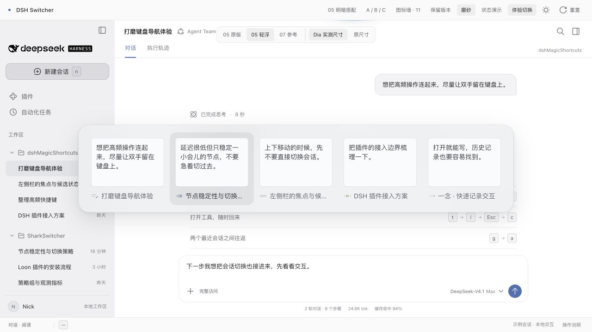

# DSH Switcher

面向 DeepSeek Harness 的 Ctrl + Tab 会话切换器。独立于 `dshMagicShortcuts` 开发。

当前仓库保存可运行的设计基线与历史探索。会话来自示例数据，尚未接入 DSH 宿主，也不是可安装的正式插件包。

## 运行

使用 Node.js 20 或更新版本，无需安装依赖：

```sh
npm run dev
```

打开 http://127.0.0.1:4382/?mode=raised&theme=light&size=dia 。`npm run check` 检查源码语法和本地资源引用。
端口被占用时可用 `npm run dev -- --port 4383`，服务只监听本机。

页面默认展示切换器。浏览器可能截获 Ctrl + Tab，可用「体验切换」按钮，再用 Tab / Shift + Tab 或方向键选择、Enter 确认、Esc 取消；「快速往返」体验最近两个会话之间切换。

## 已选设计

- 横向最近会话，展示最后一次用户输入、会话标题和状态。
- 05 亮色材质；05 暗色使用轻浮层修订。
- Dia 实测布局：整体 942 × 190、单项 182 × 158、内容面 158 × 106。窄窗口横向滚动。
- 完整的 11「五拍」状态图标，20px 槽位；选中项不缩放。
- 浮层不放标题或底栏提示。比较工具仅供原型使用。



[暗色预览](design/preview-dark.png) · [迁移验证](design/verification.md)

## 目录

```text
src/                 当前切换器的交互、动效和样式
demo/                示例 DSH 工作区、示例会话与设计比较控件
design/archive/      历史方案的独立源码副本
design/baseline.md   当前设计决策与尺寸依据
design/migration.json 迁入文件的来源及校验值
scripts/             无第三方依赖的预览服务与源码检查
index.html           当前基线入口
```

主入口仅引用本仓库的 `src/` 与 `demo/`。历史方案在 `design/archive/` 中独立浏览，原项目中的原件及 Like 数据保留。Like 保存在浏览器对应来源的 localStorage；更换端口不会自动同步旧的收藏。

后续宿主适配与正式插件代码也在本仓库实现；不把原导航插件的单键、which-key 或工具标签逻辑作为 Switcher 的运行依赖。`demo/` 中的这些表现仅用于还原预览背景。产品展示名为 **DSH Switcher**，仓库名为 `dsh-switcher`。
