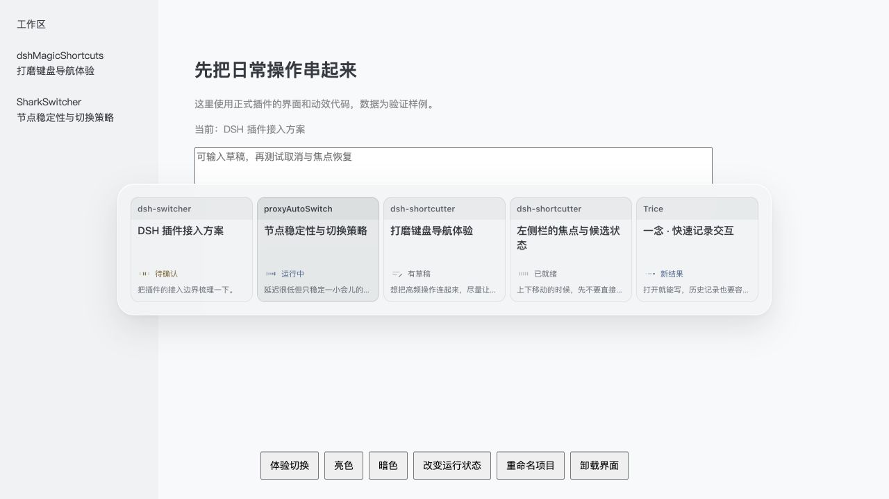
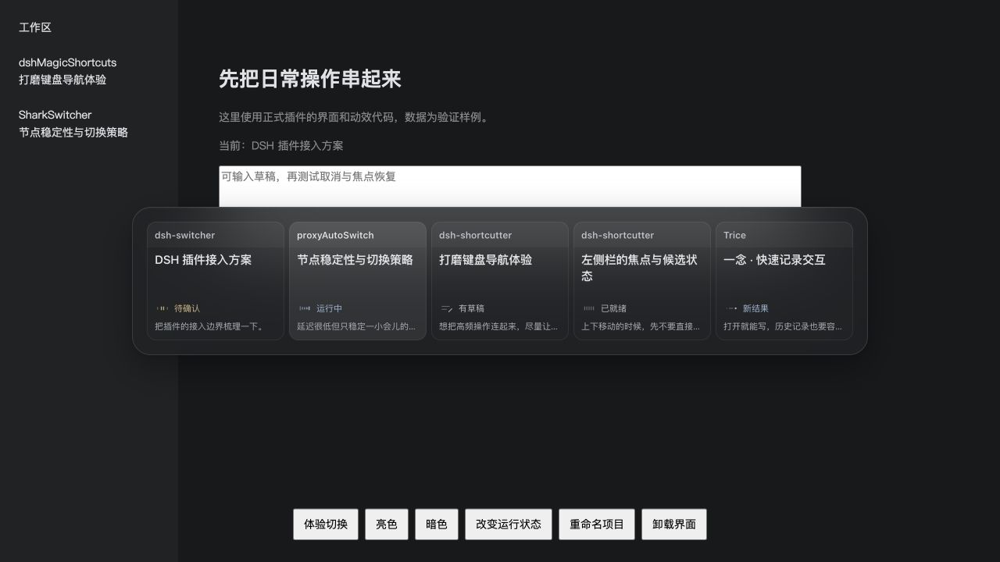
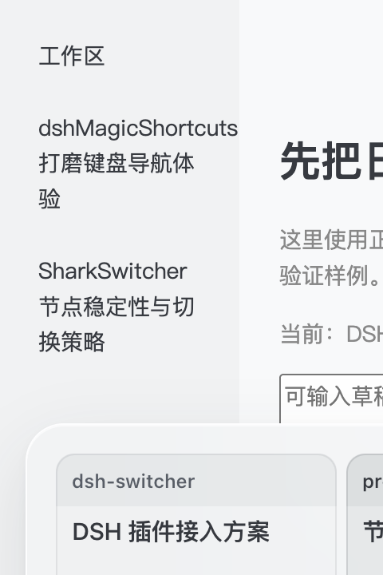
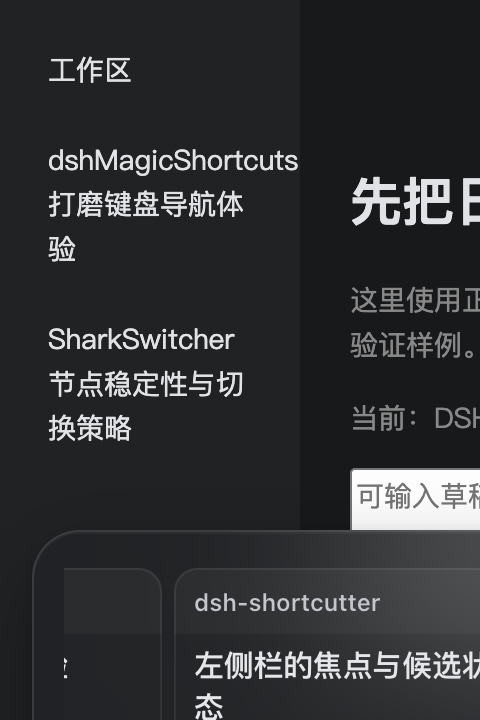

# 0.1.8 · 打开时隐藏光标

每次打开时，光标在 Switcher 面板内隐藏；鼠标第一次移动后恢复。面板外不隐藏，关闭、取消或卸载时自然恢复。打开后的静止鼠标不会抢走键盘选择，鼠标点击仍可直接确认，包括 macOS Ctrl 点击。

参考了 SharkSwitcher 当前源码的 `SwitcherInteraction.open` / `pointerHoverEnabled`、`SwitcherPanelController` 的本地 mouseMoved 监听和 `docs/ARCHITECTURE.md`：每次打开先让键盘选择生效，真实移动后再允许鼠标接管。该源码没有隐藏光标调用，本次根据用户要求在 DSH 的网页面板内补充 CSS 光标隐藏；不依赖 SharkSwitcher 源码或原生辅助程序。

## 实现

- 创建浮层时设置 `data-pointer=keyboard`，只对面板及其子元素设置 `cursor: none`。
- 浮层捕获有位移的 pointermove 后，一次性切换为 mouse；不使用 pointerenter / pointerover 唤醒，避免浮层出现、布局或滚动把静止光标当作主动选择。
- 沿用已有的移动选中与点击提交路径，没有新增全局监听、轮询、卡片内容刷新或鼠标锁定。
- 关闭即移除浮层，下次打开重新隐藏。当前打开期间重新使用键盘不会再次隐藏光标。

## 验证

- 既有 19 项测试、语法/本地引用检查（133 脚本、298 引用）和构建通过。
- `demo/plugin.html` HTTP fixture 使用正式视图、样式和动效，合成会话数据。10 项操作检查记录在 [browser-checks.json](browser-checks.json)：打开时面板全部后代隐藏、面板外可见、键盘循环保持隐藏、鼠标移动后恢复、重开重置、Ctrl 点击立即提交、关闭/卸载清理、明暗与窄窗。控制台无 error。
- 移动验证使用工具的 drag 在面板留白内产生 pointermove；普通 click 工具不一定发送位移事件，不能将其当作移动的证据。未用合成鼠标图像声称原生光标验证。
- 常规尺寸为 942×190；480px 窄窗为 448×190，末项滚动到 494px 后完整可见，页面无横向溢出。截图仅核对布局与材质，不包含系统光标，不能单独证明隐藏行为。
- 官方 CLI 已安装至 desktop profile，5 个包内文件与 0.1.8 tgz 逐字节一致，记录见 [install.json](install.json)。真实 DSH Ctrl+Tab 正常打开，Esc 取消后保留原会话。
- 本轮原生可访问树不提供光标可见性，因此光标状态证据来自浏览器 CSS 与输入检查；没有声称完成原生光标截图验证，也未重新采样独立 Control 松键。

安装前保留 0.1.7 备份。其他依赖、三份宿主配置及应用 app.asar 未变化；回退只重新安装旧 Switcher 包。
